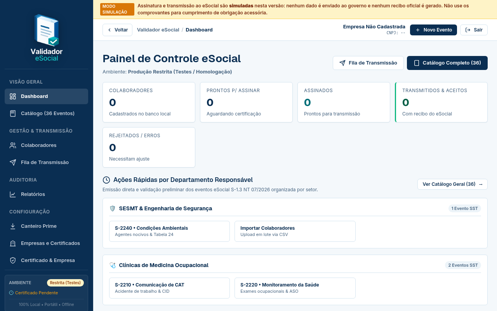

# Validador eSocial

<p align="center">
  
</p>

[](LICENSE)
[](https://github.com/forg3/validador-esocial/releases)
[](go.mod)

Programa livre e gratuito que roda no seu computador para **gerar** eventos do eSocial (leiaute S-1.3), **validar** o XML contra os XSD oficiais, **assinar** com e-CNPJ ou e-CPF A1 e **transmitir** ao webservice do governo. Cobre S-1000, S-1005, S-2200, S-2210, S-2220 e S-2240. Os dados e o certificado ficam na sua máquina.



*Painel inicial, com banco vazio.*

## Para quem

- **Técnicos e engenheiros de segurança do trabalho (TST/SESMT):** CAT (S-2210) e condições ambientais (S-2240) sem depender do sistema de folha.
- **Clínicas e médicos do trabalho:** ASO (S-2220).
- **RH, DP e contabilidade:** cadastro do empregador, estabelecimentos e admissão (S-1000, S-1005, S-2200), com conferência de XSD antes do envio.
- **Desenvolvedores:** código em Go, binário único, sem banco externo; leiautes e tabelas oficiais embutidos.

## Instalação

Baixe o pacote da [última release](https://github.com/forg3/validador-esocial/releases/latest) e confira o `SHA256SUMS`.

| Sistema | Arquivo | Como abrir |
| :-- | :-- | :-- |
| Linux (x86_64) | `.tar.gz`, `.deb` ou `.rpm` | extrair e rodar `./validador-esocial`, ou `sudo dpkg -i` / `sudo rpm -i` |
| Windows (x86_64) | `.zip` ou `.msi` | rodar `validador-esocial.exe` ou instalar o `.msi` |
| macOS Apple Silicon | `darwin-arm64.tar.gz` | extrair e rodar o binário |
| macOS Intel | `darwin-amd64.tar.gz` | extrair e rodar o binário |

No macOS, se o sistema bloquear o binário, libere em Ajustes do Sistema, Privacidade e Segurança. Também há imagem de container: `ghcr.io/forg3/validador-esocial`.

A partir do código-fonte (Go 1.26 ou superior):

```bash
git clone https://github.com/forg3/validador-esocial.git
cd validador-esocial
go run ./cmd/server
```

O programa escuta só em `127.0.0.1:8000` e abre o navegador. A senha local é exibida no terminal na primeira execução (ou defina com `-senha` ou `ESOCIAL_SENHA`). A validação por XSD usa o `xmllint` (pacote `libxml2-utils` no Linux); sem ele a interface avisa que a conferência ficou degradada.

## Uso em 5 passos

1. Abra `http://localhost:8000` e entre com a senha local.
2. Em **Empresas e Certificados**, cadastre a empresa e carregue o certificado A1 (`.pfx` ou `.p12`).
3. Em **Catálogo** ou **Novo Evento**, preencha o evento; o XML S-1.3 é gerado e validado contra o XSD.
4. Na **Fila de Transmissão**, assine informando a senha do certificado.
5. Em **Certificado & Empresa**, escolha o ambiente (produção restrita ou produção) e o modo **Real**; transmita e consulte o recibo.

O modo padrão é **simulado**: nada é enviado ao governo, a assinatura é marcada como simulada e nenhum recibo é gerado. Para outro endpoint, use `ESOCIAL_WS_ENVIO` e `ESOCIAL_WS_CONSULTA`.

## Integração com o Canteiro Prime (opcional)

Quem usa o [Canteiro Prime](https://www.laudix.com.br) pode enviar a CAT para este programa, que assina e transmite no computador que tem o certificado e devolve o recibo. O Canteiro nunca recebe o certificado.

1. No Canteiro Prime, em `/esocial/agente`, crie um token e copie na hora.
2. Na ocorrência, gere a CAT e clique em **Enviar ao agente local**.
3. Aqui, abra **Canteiro Prime**, cole o endereço (https) e o token. Ficam em `dados/canteiro.json` (permissão `0600`); `CANTEIRO_URL` e `CANTEIRO_TOKEN` têm precedência.
4. **Buscar CATs pendentes**, depois validar, assinar, transmitir e **Enviar resultado ao Canteiro**.

Sem a integração, o programa funciona do mesmo jeito. Endereço sem https só é aceito para `localhost`.

## Segurança e privacidade

- O certificado e a senha dele nunca saem do computador; a senha é pedida a cada assinatura e não é gravada.
- Sem telemetria: as únicas conexões de saída são ao webservice do eSocial (modo Real) e ao Canteiro Prime, se você configurar.
- Banco SQLite local com `secure_delete` ligado, arquivos com permissão `0600`. Após a entrega do recibo, o XML da CAT é apagado da fila local, por ser dado de saúde.
- Acesso por senha, sessão `HttpOnly` e `SameSite=Strict`, anti-CSRF, validação de `Host`, limites de upload e limite de tentativas de login.
- Relatórios: [pente fino e pentest](docs/security-audit/pente-fino-2026-09-26.md) e [auditoria de segurança](docs/security-audit/relatorio-auditoria-seguranca.pdf). Para reportar falhas, veja [SECURITY.md](SECURITY.md).

## Limitações conhecidas

- Fase **alpha**. O ciclo S-1000, S-1005, S-2200 e S-2220 foi aceito com recibo na Produção Restrita (28/09/2026) com e-CNPJ A1; S-2210 e S-2240 usam o mesmo caminho, mas não têm o mesmo registro de teste real.
- Eventos de SST exigem o trabalhador já cadastrado no eSocial (S-2200).
- Certificado A3 (token ou smartcard) só em build dedicada: `go build -tags pkcs11 ./cmd/server`; falta validação com token físico.
- Não é sistema de folha: não calcula holerite, encargos nem rescisão.
- Não substitui a responsabilidade técnica do profissional habilitado sobre laudos (LTCAT, PGR, PCMSO) e CAT.
- O [catálogo de 36 eventos](docs/eventos.md) lista todos; só os seis acima têm gerador validado contra o XSD.
- Não use comprovantes do modo simulado para cumprir obrigação acessória.

## Contribuir

Veja [CONTRIBUTING.md](CONTRIBUTING.md). Abra uma issue antes de mudanças grandes. Respondemos em até 48 horas úteis, sem SLA. Histórico de versões em [CHANGELOG.md](CHANGELOG.md).

## Licença

[MIT](LICENSE).

## Como citar

> Laudix Engenharia e Inovação. *Validador eSocial* (versão 1.4.0-alpha) [software]. 2026. https://github.com/forg3/validador-esocial

Metadados em [CITATION.cff](CITATION.cff).

## English summary

Validador eSocial is free, MIT-licensed software that runs on your own computer to generate, validate (against the official XSD), sign (ICP-Brasil A1 e-CNPJ/e-CPF certificates) and transmit Brazilian eSocial events S-1000, S-1005, S-2200, S-2210, S-2220 and S-2240 (layout S-1.3). Data and certificates never leave your machine; there is no telemetry. It targets occupational safety technicians, HR, accountants and developers. The UI is in Portuguese. Install from the [releases](https://github.com/forg3/validador-esocial/releases) (Linux, Windows, macOS) or run `go run ./cmd/server`. Status: alpha. Issues are answered within 48 business hours, with no SLA.

---

Mantido pela **[Laudix — Engenharia e Inovação](https://www.laudix.com.br)**. Página do projeto: [laudix.com.br/validador-esocial](https://www.laudix.com.br/validador-esocial.html).
